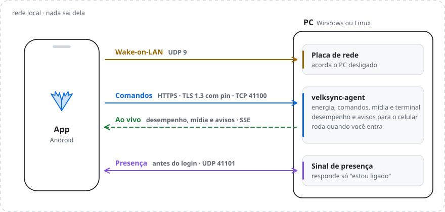

<p align="center"></p>

# Velksync

[](https://github.com/JVM3L0/Velksync/actions/workflows/ci.yml)

Liga, desliga e roda comandos no PC (Windows e Linux, dual boot) pelo celular, na rede local. O PC também manda ações para o celular.

<picture>
  <source media="(prefers-color-scheme: dark)" srcset="docs/arquitetura-dark.svg">
  
</picture>

**Começo rápido no Windows:** baixe o `velksync-setup-…-windows-amd64.exe` na [página de versões](https://github.com/JVM3L0/Velksync/releases/latest), abra e siga as telas. No fim, escaneie o QR com o app.

- `agent/`: agente em Go. Um binário para Linux e um `.exe` para Windows.
- `app/`: app Flutter (Android; iOS com ressalvas, ver abaixo).

## 1. Preparar o PC para Wake-on-LAN

1. **BIOS/UEFI**: ative "Wake on LAN" / "Power On By PCI-E". Ligue o PC **por cabo**: WoL por Wi-Fi quase nunca funciona.
2. **Windows**: o instalador confere e corrige os itens abaixo (ou rode `velksync-agent doctor`, e `-fix` para corrigir, como administrador). À mão:
   - Gerenciador de Dispositivos → placa de rede → *Avançado*: "Wake on Magic Packet" = Ativado.
   - Na aba *Gerenciamento de Energia*, marque "Permitir que este dispositivo ative o computador".
   - Desative a **Inicialização Rápida** (Painel de Controle → Opções de Energia → Escolher a função dos botões). Com ela ativa, o desligamento é uma hibernação e a placa costuma não acordar.
3. **Linux**: `sudo ethtool -s <interface> wol g`. Para persistir, use NetworkManager: `nmcli c modify <conexão> 802-3-ethernet.wake-on-lan magic`.
4. **Dual boot**: o WoL liga o PC no sistema padrão do GRUB/boot manager. O MAC é o mesmo nos dois sistemas, então no app é um único PC, que mostra qual SO está rodando.
5. Reserve um IP fixo para o PC no DHCP do roteador.

## 2. Instalar o agente

**Use o mesmo token mestre nos dois sistemas.** Instale primeiro em um, veja o token com `velksync-agent token` e passe-o ao instalar no outro. Dele derivam o certificado HTTPS e as credenciais dos celulares, então os dois sistemas do dual boot são o mesmo PC para o app.

### Windows: instalador

Baixe o `velksync-setup-<versão>-windows-amd64.exe` e o `SHA256SUMS` na [página de versões](https://github.com/JVM3L0/Velksync/releases/latest) e abra o instalador. Ele pede administrador e mostra, nesta ordem:

1. **Boas-vindas**: o que vai ser instalado (ou atualizado, se já houver uma instalação).
2. **Wake-on-LAN**: confere cabo, "Wake on Magic Packet", a permissão da placa para ligar o PC, a Inicialização Rápida e se a rede está como Privada. Cada item com problema tem uma caixa "Corrigir"; nada muda sem ela marcada. A BIOS não dá para ver de dentro do Windows: veja a seção 1.
3. **Dual boot**: primeira instalação ou "já instalei no Linux", com o token de lá (que vai por arquivo temporário, nunca pela linha de comando nem pelo log).
4. **Pronto**: marque "Parear um celular agora" e escaneie o QR com o app. A janela do QR fecha sozinha quando o celular parear.

#### O que o instalador muda no PC

Tudo isto é desfeito pelo desinstalador:

| O quê | Onde | Para quê |
|---|---|---|
| Agente | `%LOCALAPPDATA%\Velksync\velksync-agent.exe` | Roda na sua sessão (ícone, mídia, comandos que abrem janelas). |
| Tarefa **Velksync Agent** | Agendador de Tarefas, ao entrar no Windows, como o seu usuário | Sobe o agente sem janela; reinicia se cair. |
| Sinal de presença | `%ProgramFiles%\Velksync\velksync-agent.exe` | Responde "estou ligado" antes do login. |
| Tarefa **Velksync Presence** | Agendador de Tarefas, no boot, como `LocalService` (conta sem privilégios) | Sobe o sinal de presença antes de qualquer login. |
| Segredo de presença | `%ProgramData%\Velksync\presence.json` | Só leitura para o `LocalService`; escrita só para Administradores. Nunca contém o token mestre. |
| Firewall | Regras "Velksync TCP" (41100), "Velksync UDP" e "Velksync Presence UDP" (41101) | Entrada liberada só em rede **Privada** e só para a sub-rede local. |
| Configuração | `%APPDATA%\velksync\config.json` | Token mestre e celulares pareados. Fica na atualização; na remoção, você escolhe. |
| Wake-on-LAN (opcional) | Placa de rede, Inicialização Rápida, perfil da rede | Só os itens que você marcou em "Corrigir". |
| Aplicativos | Configurações → Aplicativos → Velksync | Desinstalar. |

O instalador não instala serviço do Windows, não mexe em outros programas e não manda nada para fora do PC.

#### Atualizar

O agente procura versão nova no GitHub **uma vez por dia** (desligue em **Procurar atualizações**, no menu do ícone, ou com `update_check: false`). Havendo, aparece um aviso e **Atualizar para X…** no menu do ícone. Ao confirmar, ele baixa o instalador e **só o executa se o `SHA256SUMS` estiver assinado pela chave das releases** (veja *Releases*) e o arquivo bater com ele; o Windows pede administrador e a atualização mantém a configuração e os celulares. O app também mostra "Agente X disponível no PC".

Atualizar à mão continua valendo: abra o instalador da versão nova. Para remover, use **Configurações → Aplicativos → Velksync**; ele pergunta se você quer manter a configuração (assim, reinstalar não exige parear de novo).

> **"O Windows protegeu o computador"**: o instalador não tem assinatura de código paga, então o SmartScreen avisa. Confira o arquivo antes (`(Get-FileHash .\velksync-setup-*.exe).Hash.ToLower()` deve bater com a linha dele no `SHA256SUMS`) e clique em *Mais informações → Executar assim mesmo*.

### Compilar o agente

Precisa de Go 1.26+; dá para compilar os dois no WSL/Linux:

```sh
cd agent && ./build.sh      # gera agent/dist/linux e agent/dist/windows
```

O instalador do Windows é gerado pelo [Inno Setup 6](https://jrsoftware.org/isinfo.php) (`agent/deploy/build-installer.ps1`); o CI compila e testa a cada envio.

**Linux** (serviço systemd do usuário, mais o serviço de presença do sistema, que pede `sudo`):
```sh
cd agent/dist/linux && ./install-linux.sh            # ou: ./install-linux.sh <token-do-windows>
```

**Windows sem o instalador** (o `.zip` da página de versões ou o `agent/dist/windows`; PowerShell como administrador; roda no logon, sem janela):
```powershell
cd agent\dist\windows
powershell -ExecutionPolicy Bypass -File install-windows.ps1 -Token <token-do-linux>
powershell -ExecutionPolicy Bypass -File uninstall-windows.ps1   # para remover (-RemoveConfig apaga também a configuração)
```
O script também cria a tarefa **Velksync Presence**, que sobe no boot como `LocalService` (antes de qualquer login). Para atualizar, rode o instalador de novo: ele para as tarefas, troca os binários e reinicia.

A rede do Windows precisa estar como **Privada**: as regras de firewall valem só para ela e só para a sub-rede local. No Linux, o instalador libera as portas no `ufw` também só para a sub-rede local.

> **WSL com `networkingMode=mirrored`**: o WSL reserva no Windows a faixa de portas efêmeras do Linux (`cat /proc/sys/net/ipv4/ip_local_port_range`, ex.: 44620–48715). Se o agente do Windows falhar com "Only one usage of each socket address", a porta caiu nessa faixa: troque `port` na config.

Configuração:
- Linux: `~/.config/velksync/config.json`
- Windows: `%APPDATA%\velksync\config.json`

Reinicie o agente depois de editar a config.

```json
{
  "name": "PC do quarto",
  "port": 41100,
  "token": "…",
  "allow_shell": false,
  "command_timeout_seconds": 30,
  "commands": [
    { "id": "steam", "name": "Abrir Steam", "linux": "steam", "windows": "start \"\" \"C:\\Program Files (x86)\\Steam\\steam.exe\"" },
    { "id": "lock",  "name": "Bloquear tela", "linux": "loginctl lock-session", "windows": "rundll32.exe user32.dll,LockWorkStation" }
  ]
}
```

- `commands`: aparecem como botões no app. Um comando sem variante para o SO atual fica escondido.
- `power_grace_seconds` (padrão 10, só Windows): com a sessão desbloqueada, desligar, reiniciar ou suspender pelo celular mostra uma contagem no PC, e quem está nele pode cancelar. Com a tela bloqueada, executa na hora. `0` desliga a contagem.
- `update_check` (padrão `true`): procurar versão nova no GitHub uma vez por dia. Também muda pelo menu do ícone.
- `tray_notices` (padrão `true`, só Windows): avisos quando um celular pareia, roda um comando ou agenda o desligamento. Também muda pelo menu do ícone.
- `media_idle_minutes` (padrão 10): mídia pausada há mais que isso some do app e volta quando tocar de novo. Navegadores congelam abas paradas há muito tempo: o play é aceito, mas o vídeo não toca. `0` desliga.
- `allow_shell: true`: libera o **terminal livre** no app. Qualquer celular pareado roda qualquer coisa como seu usuário; deixe desligado se não usar. No Windows os comandos rodam via `cmd.exe`; no Linux, via `/bin/sh`.
- `devices` / `revoked`: mantidos pelo agente (celulares pareados e revogados). Não edite à mão.
- Logs: `journalctl --user -u velksync-agent -f` no Linux; `agent.log` ao lado da config no Windows.

## 3. PC ↔ celular

**Do PC para o celular, pelo ícone:** copie um texto ou link no PC e use **Enviar para o celular** no menu do ícone, escolhendo um dos celulares com o app aberto. Um link abre no navegador do celular; outro texto vai para a área de transferência dele (até 64 KB).

**Do celular para o PC:** em qualquer app, **Compartilhar → Velksync** com um texto ou link e escolha o PC (só os ligados). Um link `http(s)` abre no navegador do PC; outro texto vai para a área de transferência dele, com aviso no ícone. Só texto: nada é executado, e `file:`, `javascript:` e afins chegam como texto. No Linux, por enquanto, só links.

Tudo que vai e vem fica no **histórico** (abaixo), sem o conteúdo.

Pela linha de comando, com o app aberto, o PC também pode mandar:

```sh
velksync-agent send notify "Render terminou"
velksync-agent send clipboard "texto que vai para o celular"
velksync-agent send open_url https://example.com
velksync-agent send vibrate
```

Dá para usar no fim de scripts, por exemplo `make && velksync-agent send notify ok`. **Limitação**: só chega enquanto o app estiver aberto ou em primeiro plano. Receber com o app fechado exige push (FCM) ou um serviço em segundo plano no Android.

## 4. Ligado antes do login (sinal de presença)

O agente principal só roda depois do login. Para o app saber que o PC já ligou (por exemplo, parado na tela de login depois do Wake-on-LAN), um processo mínimo, `velksync-agent presence`, sobe no boot e responde só a um desafio na porta UDP 41101: o celular manda um número aleatório e o PC devolve um HMAC dele com um segredo derivado do token mestre, que o app aprende ao parear. Ninguém sem o segredo consegue fingir que o PC está ligado, e a resposta não revela nada além disso.

No app aparece **Aguardando login**. O processo roda sem privilégios (`LocalService` no Windows; usuário dinâmico e sandbox do systemd no Linux), lê só o arquivo do segredo e responde no máximo 10 vezes por segundo por IP.

## 5. Desempenho do PC

O painel do PC no app mostra CPU, GPU, memória e disco em tempo real, no estilo do dashboard do Caelestia. Com agentes v0.4+, o PC empurra as leituras pelo canal ao vivo a cada 2 s, e só enquanto a tela do PC está aberta no app. Tocar em CPU, GPU ou Memória abre o gráfico dos últimos 2 minutos (mínimo, média e máximo), que o app vai guardando na memória enquanto você está na tela do PC. Fontes:

- **Windows**: APIs nativas (as mesmas do Gerenciador de Tarefas). O Windows não expõe temperaturas sem driver de terceiros, então elas não aparecem.
- **Linux**: `/proc` e `/sys`; GPU AMD pelo driver `amdgpu` e temperatura da CPU pelo `k10temp`/`coretemp`.

Abaixo, **Processos** lista os 10 programas que mais usam CPU ou memória (os processos do mesmo programa somados, como as várias abas de um navegador). Só leitura: nada é encerrado pelo app. O PC só é consultado com a aba aberta.

## 6. Mídia

A aba **Mídia** mostra o que está tocando no PC (capa, título, artista, posição) e controla play/pause, anterior, próxima, posição e o volume do PC. Funciona com qualquer player que se integre ao sistema: Spotify, navegadores, VLC etc.

- O fundo e os controles seguem as cores da capa; capas de vídeo mantêm o formato 16:9.
- Arraste a capa para os lados para trocar de faixa (só pula depois de 40% da largura ou num gesto rápido e longo, com vibração no ponto).
- O volume fica num botão ao lado do título, que abre uma pílula vertical.
- Depois de um comando, o agente lê o player várias vezes seguidas: a faixa nova aparece em cerca de 0,2 s.

- **Windows**: controles de mídia do sistema (o painel de mídia do Windows) e Core Audio para o volume. Um auxiliar do PowerShell embutido no agente é iniciado sob demanda, oculto, e se encerra após 2 minutos sem uso.
- **Linux**: MPRIS via D-Bus; volume pelo `wpctl` (PipeWire) ou `pactl` (PulseAudio).

**Capas pequenas no Windows.** Navegadores e apps feitos sobre o Chromium (Chrome, Edge, o YouTube Music instalado pelo navegador, o Pear Desktop) entregam ao Windows a capa já reduzida para ~120 px, um valor fixo no código do Chromium. Com o **Pear Desktop** dá para contornar: ligue o plugin *API Server* com o hostname **`127.0.0.1`** (o padrão `0.0.0.0` abre a API para toda a rede). Na primeira vez que o Pear tocar, ele pergunta se o Velksync pode acessar; permitindo, a capa vem em 1200 px dos servidores de imagem do Google. Negando, o Velksync não pergunta de novo (apague `pear_denied` da config para perguntar).

A capa só é entregue se o arquivo for de fato uma imagem, e só vem de `file://` ou `https://`: um player ou página maliciosa não consegue usar o endereço da capa para vazar arquivos do PC nem acessar a rede interna.

## 7. Agendar

Com o PC ligado, **Agendar** desliga ou suspende depois de um tempo (1 minuto a 24 horas) ou **quando a mídia parar**. O PC avisa o celular 1 minuto antes (com o app aberto, como os outros avisos do PC) e dá para cancelar pelo app. O agendamento fica só na memória do agente: reiniciar o PC ou o agente cancela.

## 8. Atalho e widget (Android)

- **Configurações rápidas**: bloco **Ligar PC**, que manda o Wake-on-LAN sem abrir o app.
- **Widget** (tela inicial → Widgets → Velksync): nome do PC, último estado visto pelo app ("visto às 16:40") e um botão que pede confirmação. Com o PC desligado, **Ligar** num diálogo do próprio Android; ligado, **Desligar** abre o app, que confere o estado real e pergunta antes.
- Os dois usam o PC escolhido em **Configurações → Bloco "Ligar PC"**. Nenhum deles guarda credenciais: só nome, MAC e estado.

## 8.1 Ícone na bandeja (Windows)

O agente mostra o ícone do Velksync perto do relógio. Pelo menu (botão direito ou clique):

- **Parear um celular…**: janela com o QR, que fecha sozinha quando o celular parear. O QR não vai para o disco.
- **Celulares pareados**: lista com **Revogar…** para cada um.
- **Conferir Wake-on-LAN…**: o mesmo diagnóstico do instalador; **Corrigir** pede administrador só nessa hora.
- **Cancelar** um desligamento agendado, quando houver.
- **Enviar para o celular**: o texto ou link copiado no PC, para um dos celulares com o app aberto.
- **Histórico…**: as últimas ações (veja abaixo).
- **Avisar o que os celulares fazem**: liga ou desliga os avisos do Windows.
- **Procurar atualizações agora**: consulta na hora, mesmo com a checagem automática desligada.
- **Abrir o log**, **Abrir a pasta da configuração** e **Sair do agente…** (volta no próximo login; ligar pelo celular continua funcionando).

Quando um celular pede para desligar, reiniciar ou suspender com alguém usando o PC (sessão desbloqueada), aparece uma contagem de 10 s com **Cancelar** (o botão padrão) e **Desligar agora**. Se alguém cancela, o celular recebe o aviso. Com a tela bloqueada, executa na hora.

## 8.1.1 Histórico de ações

O agente guarda as últimas 200 ações em `history.json`, ao lado da config: quem desligou, reiniciou ou suspendeu (e quem cancelou no PC), agendamentos, comandos, terminal (só o comando, nunca a saída, e só visível com o terminal livre ligado), pareamentos, revogações, atualizações e textos trocados (sem o conteúdo). No app, **Atividade recente** na aba Controle mostra as 3 últimas e **Ver tudo** o resto; no PC, **Histórico…** no menu do ícone.

## 8.2 Atualizar o app

O app procura versão nova uma vez por dia, ao abrir (desligue em **Configurações → Atualizações**, onde também fica **Procurar agora**). Havendo, aparece um cartão no topo da lista de PCs: **Atualizar** baixa o APK do processador do celular, só do GitHub e por HTTPS, confere com o `SHA256SUMS` e abre o instalador do Android. Na primeira vez o Android pede para liberar "Instalar apps desta fonte" para o Velksync. O Android só instala por cima um APK assinado com a mesma chave do app instalado, então um arquivo trocado é recusado por ele também. O app de desenvolvimento ("Velksync Dev") não se atualiza.

## 8.3 Primeira vez

Sem nenhum PC cadastrado, o app abre um passo a passo: o que é o Velksync, como instalar o agente (com o link do instalador para copiar), parear pelo QR ou pela busca na rede e um teste de **Ligar**, com as dicas de Wake-on-LAN se o PC não responder. Dá para pular em qualquer passo.

## 9. Rodar o app

```sh
cd app
flutter pub get
flutter run          # com o celular conectado (depuração USB ou sem fio)
flutter build apk    # APK de release em build/app/outputs/flutter-apk/
```

No app, em **Adicionar PC → Escanear QR do PC**: com o agente rodando, execute `velksync-agent pair` no PC e aponte a câmera. No Linux o QR aparece no terminal; no Windows abre como imagem (o instalador oferece isso no fim). O QR leva o pin do certificado do PC e um código de uso único (5 minutos), trocado por uma credencial só deste celular. O `pair` percebe a leitura e apaga a imagem sozinho (também apaga se expirar ou com Ctrl+C).

Sem o QR dá para cadastrar um PC só com IP e MAC: ele fica "não pareado" e serve apenas para ligar. Para controlar, edite o PC e escaneie o QR.

Celulares pareados:
```sh
velksync-agent devices                 # lista os celulares pareados e revogados
velksync-agent revoke "motorola edge"  # revoga por nome ou id (no dual boot, nos dois sistemas)
velksync-agent fingerprint             # pin do certificado; confira com o mostrado no app
```

O `flutter run` instala o **Velksync Dev** (`com.velksync.velksync.debug`), que convive com o app da release e tem seus próprios pareamentos.

Use um **celular de verdade no mesmo Wi-Fi**. O emulador Android fica atrás de NAT, então broadcast (WoL e descoberta) não chega na sua rede.

**iOS**: a conexão com o agente funciona. Já broadcast UDP (WoL e descoberta) exige o entitlement `com.apple.developer.networking.multicast`, que a Apple precisa aprovar. Até lá, cadastre o IP manualmente; o botão Ligar não vai funcionar.

## Releases

Cada tag `vX.Y.Z` enviada ao GitHub dispara o workflow `.github/workflows/release.yml`, que testa tudo e publica na página de Releases: APKs assinados, um por processador (no celular, baixe o **`-arm64.apk`**; aparelhos antigos, o `-armv7.apk`), agente para Linux (`.tar.gz`) e Windows (instalador `velksync-setup-….exe` e `.zip`), `SHA256SUMS`, `SHA256SUMS.sig` (assinatura Ed25519, que o atualizador do agente exige) e atestado de proveniência (repositórios públicos). As novidades da página vêm da seção da versão no `CHANGELOG.md`. A tag precisa bater com a versão em `agent/main.go` e `app/pubspec.yaml`.

Configuração única da chave de assinatura do app:

```sh
keytool -genkeypair -keystore velksync-release.jks -storetype PKCS12 -alias velksync \
  -keyalg RSA -keysize 4096 -validity 10000 -dname "CN=Velksync"
base64 -w0 velksync-release.jks   # conteúdo do secret ANDROID_KEYSTORE_BASE64
```

Em *Settings → Secrets and variables → Actions* do repositório, crie `ANDROID_KEYSTORE_BASE64`, `ANDROID_KEYSTORE_PASSWORD`, `ANDROID_KEY_ALIAS` (`velksync`) e `ANDROID_KEY_PASSWORD` (com PKCS12, a mesma senha da keystore). **Guarde o `.jks` e a senha num backup seguro**: sem eles não dá para publicar atualizações que o Android aceite por cima da versão instalada. Nunca coloque o `.jks` no repositório (o `.gitignore` bloqueia).

### Chave de assinatura das releases

Configuração única. A chave privada nunca entra no repositório:

```sh
openssl genpkey -algorithm ed25519 -out ~/velksync-release-signing.pem && chmod 600 ~/velksync-release-signing.pem
openssl pkey -in ~/velksync-release-signing.pem -pubout -out agent/release_key.pem   # pública, vai no repositório
base64 -w0 ~/velksync-release-signing.pem                                            # Secret RELEASE_SIGNING_KEY
```

A release assina o `SHA256SUMS` e confere com `agent/release_key.pem` antes de publicar. **Guarde a chave privada num backup seguro**: sem ela, os agentes instalados recusam as próximas atualizações automáticas (atualizar à mão continua funcionando).

## Segurança

| Camada | Como |
|---|---|
| Canal | HTTPS (só TLS 1.3) com o certificado do PC fixado no app pelo hash da chave pública, que vem no QR. Sem o pin certo o app não conversa; um impostor na rede não consegue se passar pelo PC. |
| Credenciais | Cada celular recebe `id:token` próprio (HMAC do token mestre), revogável com `velksync-agent revoke`. O token mestre só é aceito vindo do próprio PC (localhost) e nunca sai dele. |
| Pareamento | Código de uso único, 128 bits, válido por 5 minutos, que nunca circula sem TLS. |
| Força bruta | 10 falhas de autenticação em 1 minuto bloqueiam o IP por 5 minutos. |
| Servidor | Limites de tempo de leitura e de cabeçalho; no máximo 3 canais ao vivo por celular. |
| Presença | Desafio-resposta com HMAC e segredo próprio (derivado do token mestre); processo sem privilégios, sandbox no Linux, limite de respostas por IP. |
| Bandeja (Windows) | Nenhuma porta nova: o menu faz o que a linha de comando já faz, como o seu usuário. A contagem antes de desligar só se cancela no próprio PC. Avisos mostram o nome do celular e do comando, nunca a saída. |
| Troca de textos | Só entre celulares pareados e o PC. Link só `http(s)`; o resto é texto na área de transferência, nunca executado. O celular escolhe o PC antes de enviar; o PC avisa o que recebeu. O histórico guarda o fato, não o conteúdo. |
| Atualizações | Agente e app só baixam do GitHub por HTTPS, com limite de tamanho. O agente só roda o instalador se o `SHA256SUMS` tiver a assinatura Ed25519 das releases e o arquivo bater; o Android só aceita APK com a mesma assinatura do app. Nada é instalado sem a pessoa confirmar no próprio aparelho. |
| Widget e atalho | Só nome, MAC e estado; desligar sempre passa pelo app e pede confirmação. Componentes internos não exportados. |
| Rede | Firewall liberado só para a sub-rede local (Windows: rede privada; Linux: `ufw`). |
| Celular | Credenciais no Android Keystore (`flutter_secure_storage`), backup e transferência entre aparelhos desligados, sem HTTP em texto puro. |
| Padrões | Terminal livre desligado por padrão; comandos com tempo limite e saída limitada. |

Testes das regras de segurança: `cd agent && go test ./...` e `cd app && flutter test`.

Não exponha a porta 41100 na internet. Para acesso de fora de casa, use uma VPN (Tailscale/WireGuard).

### Atualizando da v0.3

Rode o instalador de novo nos dois sistemas: ele instala o sinal de presença e o agente com o canal ao vivo, o agendamento e o conserto do volume no Windows. Os celulares continuam pareados. O app aprende o segredo de presença sozinho na primeira vez que falar com o PC atualizado.

### Atualizando da v0.1

A v0.2 troca HTTP por HTTPS e o token único por credenciais por celular. Atualize o agente nos dois sistemas e o app; os PCs já cadastrados aparecem como "não pareados" (ligar continua funcionando) até você editar cada um e escanear o QR de novo.

## Próximos passos possíveis

- Ligar o PC fora de casa: dispositivo sempre ligado na LAN (Raspberry Pi/roteador) + Tailscale.
- Notificações reais (`flutter_local_notifications`) e recebimento em segundo plano.
- Controles de mídia na notificação e na tela de bloqueio (ver `ROADMAP.md`).

## Licença

[GPL-3.0](LICENSE): você pode usar, estudar, modificar e redistribuir, inclusive comercialmente, desde que versões modificadas distribuídas também sejam GPL-3.0 com o código-fonte disponível.

Exceção: `.claude/skills/mobile-app-ui-design/` é adaptada de [ceorkm/mobile-app-ui-design](https://github.com/ceorkm/mobile-app-ui-design), sob MIT (compatível com a GPL-3.0).
